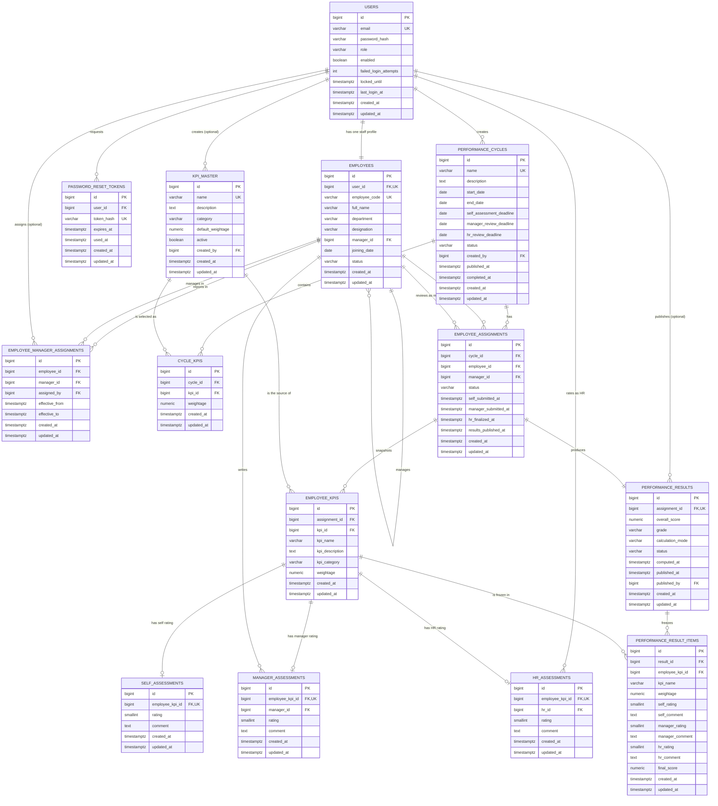

# Evalora — ER Diagram

This diagram mirrors the implemented schema in `database/migrations/V1__init_schema.sql` plus the Phase 3B4
`V2__employee_manager_assignments.sql` and `V3__case_insensitive_employee_code_uniqueness.sql`, and the JPA entities in
`com.evalora.backend.entity`. Every table, column and relationship shown here exists in the database.

## How to read it

- `||--||` one-to-exactly-one, `||--o{` one-to-many (zero or more), `||--o|` one-to-zero-or-one.
- `PK` primary key, `FK` foreign key, `UK` unique key.
- `timestamptz` columns hold UTC instants.

## Relationship walkthrough

**Users and profiles.** A `users` row is created for every HR, manager and employee account. Each one gets exactly
one `employees` row holding the staff data. The role is stored only in `users`.

**Reporting line.** `employees.manager_id` points back to `employees.id`. This is a unidirectional self-reference:
a manager has no `subordinates` collection, which avoids lazy-loading loops and infinite JSON. The database forbids
`manager_id = id`.

`employee_manager_assignments` (V2) records each reporting period with `effective_from`/`effective_to`. A null
`effective_to` is the current assignment, and a partial unique index allows only one open row per employee. Reassigning
closes the old row and appends a new one, so reporting history is never overwritten; `employees.manager_id` is kept in
sync as the current pointer.

**Cycle setup.** HR creates a `performance_cycles` row, selects KPIs into `cycle_kpis`, and adds employees. Publishing
creates one `employee_assignments` row per employee, plus one `employee_kpis` snapshot per configured KPI.

**Ratings.** Each `employee_kpis` row accepts at most one row in each of `self_assessments`, `manager_assessments`
and `hr_assessments`. The unique constraints are what make a second submission impossible, not just service code.

**Result.** Finalising creates exactly one `performance_results` row (unique on `assignment_id`) and one
`performance_result_items` row per KPI, copying the name, weight, ratings, comments and computed score. Publishing
only changes `status`/`published_at`; the numbers never change afterwards.

## Where the arithmetic lives

No score is computed by the database. `performance_result_items.final_score` and
`performance_results.overall_score` are written by `PerformanceScoreCalculator` during HR submission in Phase 3H,
using `BigDecimal` and `RoundingMode.HALF_UP` for the overall score. The database only enforces that the stored values are inside the valid range (1.00–5.00).
